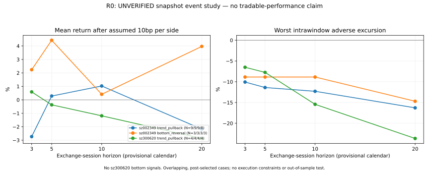

# 基础整理与 R0 首轮探索报告

**结论：长期开发骨架已建立，算法和事件评估可复现；正式可交易回测仍受数据与执行约束缺口限制。以下数值仅为未核验快照上的探索标签，不能视为样本外收益。**

## 仓库与历史成果

使用现有公开仓库 `gordonlu731/AI` 的独立分支 `quant-research-foundation`，目录 `a_share_quant/`。已有 Bellworks 分支保持原样；未访问到 ChatGPT 中的 V1–V4 文件，未假设其规则或结果。可整体迁移到独立私有 `a-share-quant` 仓库。

已建立策略定义、AGENTS 长期规范、src、tests、data、reports、research_log、依赖锁定及 Python 3.11/3.12 CI。核心使用标准库；额外行情解码环境独立。重要定义和研究结果保存到分支，默认 main 未自动合并。

## 数据核验

| 标的 | 日线范围 | 行数 | 与观测指数日期的缺口 | 同源第二接口核验 |
|---|---|---:|---:|---|
| 精华制药 002349 | 2010-02-03–2026-10-22 | 3,829 | 227 日 | 近期 1,022 根，OHLC/量一致 |
| 光库科技 300620 | 2017-03-10–2026-10-22 | 2,325 | 10 日 | 近期 1,022 根，OHLC/量一致 |

日线来自新浪真实未复权响应，独立读取供应商累计因子快照；统一按首个因子归一。缺口原因尚未逐一确认，不能直接认定停牌或直接填造交易。算法在每个缺口后重置结构并重新预热，精华制药分成 16 段、2,669 个预热后日；光库科技 2 段、2,087 个预热后日。

腾讯 raw/hfq 反推乘法因子的方案被核验拦截，保留失败记录。不同源 raw 比较另见 [cross_source_audit.json](2026-10-23-r0/cross_source_audit.json)：精华制药 7 个差异日，光库科技未发现超容差差异，不自动合并。没有取得供应商历史版本或独立权威公司行为，PIT=false；观测指数日期仅作临时日历，calendar_verified=false。

原始行情/因子/完整价格结构仅保存在被忽略的本地目录，因再分发许可未确认未提交到公开 GitHub。仓库发布来源、URL、校验和、覆盖/差异摘要及不含价格的研究标签；新容器应重新获取并对照校验和。

## 评估口径和完整结果

日 t 收盘生成信号，假设 t+1 开盘入场并重新验证 RR，持有期含入场日，以第 3/5/10/20 个市场日收盘计算。每边 10bp 仅为费用假设。未模拟止损止盈成交、封板、T+1 账户记账或组合仓位；MAE/MFE 只看日线区间。

最终代码按既定支撑/压力定义纠正后运行，初次实现的全部标签单独保留为 [superseded](2026-10-23-superseded/all_event_labels.csv)，不作为有效结果。没有根据收益改变参数。

| 股票/策略 | 信号数 | 3 日均值 | 5 日均值 | 10 日均值 | 20 日均值 |
|---|---:|---:|---:|---:|---:|
| 002349 趋势回调 | 12 | -2.73%（9） | +0.28%（9） | +1.03%（9） | -2.18%（8） |
| 002349 底部反转 | 3 | +2.24%（3） | +4.43%（3） | +0.41%（3） | +3.97%（3） |
| 300620 趋势回调 | 5 | +0.59%（4） | -0.37%（4） | -1.19%（4） | -2.87%（4） |
| 300620 底部反转 | 0 | 无样本 | 无样本 | 无样本 | 无样本 |

括号为实际可观测事件数；均值为假设费用后收益，不是组合收益。每个期限都保留 002349 的 3 个、300620 的 1 个入场 RR 失效事件；002349 的 20 日另有 1 个缺失窗口。合计 80 条标签中 63 条 observed、16 条 entry_rr_rejected、1 条 window_unavailable。

失败样本没有隐藏：002349 趋势 3 日为 8/9 亏损、20 日为 4/8 亏损；300620 趋势 20 日虽仅 1/4 亏损，但均值仍为负，最差 MAE -23.66%。002349 底部仅 3 个样本，不能因局部正均值推断有效。全部期限的均值/中位数、胜率、亏损数、最差收益、MAE/MFE、收盘路径回撤和不可评估状态见 [summary.json](2026-10-23-r0/summary.json)，全部成功/失败标签见 [all_event_labels.csv](2026-10-23-r0/all_event_labels.csv)。

## 验收、可复现性与局限

25 项自动测试、本地编译和 CLI 冒烟检查通过，GitHub Python 3.11/3.12 [CI 也已成功](https://github.com/gordonlu731/AI/actions/runs/39978767428)。测试覆盖因果时间边界、正负样本、未来数据追加后历史信号不变、日历缺口、亏损/拒绝/删失事件；合成序列只用于算法测试。

[audit.json](2026-10-23-r0/audit.json) 保存真实数据/日历/供应商响应 SHA256、参数、源文件哈希、工作树状态与全部拒绝原因计数。代码提交 [5dd6396](https://github.com/gordonlu731/AI/commit/5dd6396a7bf4f191ae254bea2e81aa73329c91bd) 后在干净工作树重跑，全部 80 条事件标签及汇总与首次输出逐字相同；发布审计对应该次已提交代码重跑。图表为相同真实运行结果的静态派生图，不含原始价格。

尚未完成：V1–V4 迁回、正式数据许可、PIT 公司行为与修订、交易所日历、历史 ST/停复牌/涨跌停、实际费用、全市场历史证券、样本外检验和组合回测。两个标的是事后指定，事件相互重叠，没有独立样本或统计显著性结论。财务与黑天鹅模块目前仅有研究计划。

下一步按 [roadmap](../docs/roadmap.md) 先补 P0 数据证据，再推进交易约束和样本外研究。
