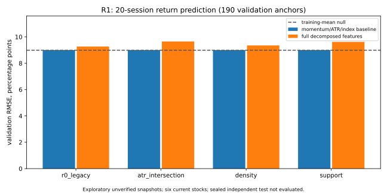

# R1-S1 结构与多空力量假设验证

本轮完成四类因果结构、两只股票逐日诊断、独立股票训练/验证事件研究和固定增量对照。**没有获得候选算法优于 R0 的确认结论，也没有正式组合回测收益。** 人工一致性等待真实评审，独立封存期未解封，历史行业数据仍缺失。

## 范围、参数与实施顺序

基线为 `gordonlu731/AI:quant-research-foundation` 的 `a6dcac7`。R0 算法、策略参数和历史报告原样保留；R1 在 `ashare_quant/r1/`、独立 `quant-r1-structure-forces` 分支。先在 `4eccb0f` 冻结 [预注册](../../research/r1/preregister.json)，`6855640` 完成结构/案例后才开展预测。最终三个阶段在干净代码提交 `2e8f824` 上复现，审计保存各源文件 SHA256。

四类结构为 R0 固定阈值交集、候选极值日冻结确认幅度的 ATR 波段交集、日线时间/量密集区、独立回踩承接区。共九个事件对照方法，包含不过期/不转换消融及 rolling20 简单基准；只有一套结构参数，没有按收益搜索阈值。完整形成/确认日期、上下沿、重心、成员、最近测试、到期/破坏/角色状态均输出到本地结构明细。终止中枢的几何已冻结，不接受后来波段更新。

规则与因果约束见 [实验定义](../../docs/r1/experiment_spec.md)，字段、单位和缺失含义见 [特征字典](../../docs/r1/feature_dictionary.md)。日 K 量只作量价描述，不推断主动买盘/卖盘。

## 人工对照与指定案例

生成 11 个指定日期四算法对照图、12 个跨六只独立股票/多个年份的盲评样本。每份盲评有无算法图和掩码 A–D 图，PNG/PDF 共 70 个文件，只使用截点以前的 K 线与量。图含已确认极值连接线、确认日叉号、中枢边界/重心、无明确中枢状态；局部线段是截点已知结构，不代表极值当日即可识别。

价格图、完整价格结构和解盲钥匙留在本地忽略目录，未向公开仓库发布供应商报价。图清单/哈希见 [figure_manifest.json](figure_manifest.json)，可用仓库脚本重新生成图包。盲评包排除解盲钥匙和指定案例；图最多画四个最近区间，完整掩码区域 CSV 保留全量算法输出。

**人工结果：pending。** 没有填写任何假评审。模板支持正确、偏高、偏低、遗漏、误识别和无明确中枢。评分工具输出 IoU、ATR 归一位置差、数量差与错误记录；不用于择优历史收益。详见 [评审步骤](../../docs/r1/human_review.md)、[人工区域模板](R1-S1-structure/human_regions_template.csv)、[判断模板](R1-S1-structure/algorithm_judgments_template.csv)。

指定案例不是独立预测样本。阶段诊断见 [structure_findings.md](structure_findings.md) 和全部逐日记录：

- [精华制药逐日诊断（gzip JSON）](R1-S1-structure/sz002349-daily-diagnostics.json.gz)：2014-11-07 趋势信号前最近放量突破为 09-09，当日 R0 中枢年龄 134 日；11-14 已出现低点失守等拒绝，但最近已完成下跌段的速度/量尚未更新。未完成段恶化、旧区间不过期和确认延迟是解释候选，不宣称新算法已能提前避险。
- [光库科技逐日诊断（gzip JSON）](R1-S1-structure/sz300620-daily-diagnostics.json.gz)：6–8 月 65 个诊断日 R0 底部信号为 0。07-31 深跌 47.26%、第一反弹 13.18%、二跌/首跌能量 0.482、收复 7.38% 均通过，拒绝在第二低点低 10.71%（超过 ±5%）和 RR 0.55（要求 2）。不能用 8 月反弹改写 7 月确认。候选方法也没有被调成必须识别出该案例。

候选密集区在某些高波动截点输出无中枢，承接区可能过宽。记录为待人工审查的潜在漏检/宽带误识别，不冒充已判定的人工错误。

## 独立事件研究与缺失记录

除两只案例外，固定新增 000001、000333、000858、600276、600900、601088 六只股票。总行情 40,451 根，均来自未核验历史时点版本的新浪当前快照；指数研究期为 2010–2026 共 4,078 根。原始数据、因子、响应和价格图未提交公开 Git。当前现存股票小面板存在幸存者/便利抽样偏差，不能推广为全市场结论。

按市场日历代理每 20 日一个共同锚点、120 根连续数据预热，最长 20 日标签在单股内不重叠。共 1,499 个登记锚点：958 ready、287 warmup、33 信号日缺数据、12 purge、6 embargo、203 独立封存锚点不评估。ready 为案例 239、独立训练 527、独立验证 192。不同方法/期限不是独立样本数量的乘法。

9 方法 × 4 期限共 34,488 条标签，33,957 observed、423 window_unavailable、72 entry_unavailable、36 censored_horizon；全部保留。独立 2024–2026 **收益标签计算数为 0**，没有封存测试分数。只有指定案例允许 2026 结构诊断，未加入独立模型训练/验证。

独立验证期无条件共同锚点（rolling20 的收益行，不按结构筛选）的结果如下；费用是每边 10bp 假设，超额相对同期上证综指价格指数，二者并非严格匹配总收益口径。

| 期限 | 可观察锚点 | 假设费用后均值 | 指数超额均值 | 平均 MAE | 平均 MFE |
|---|---:|---:|---:|---:|---:|
| 3 | 191 | -0.714% | -0.335% | -2.661% | +2.325% |
| 5 | 191 | -0.178% | -0.156% | -3.584% | +3.371% |
| 10 | 191 | +0.146% | -0.082% | -4.737% | +5.132% |
| 20 | 190 | -0.695% | -0.203% | -6.489% | +7.018% |

完整收益分布、分位数、MAE/MFE、收盘路径回撤、无中枢组、失败与未成熟状态见 [事件汇总](R1-S1-events/event_summary.json.gz)、[全部事件标签](R1-S1-events/all_event_labels.csv.gz)、[全部锚点特征](R1-S1-events/anchor_features.csv.gz)、[全部日状态](R1-S1-events/all_daily_states.jsonl.gz)。[年份/市场状态汇总](R1-S1-events/year_regime_summary.json.gz) 使用当时指数 60 日趋势，历史行业分类缺失，统一 unavailable，没有伪造行业结论。

路径先后不能按触及比例直接给中枢排名：20 日验证中，承接区有完整两界的 80 个样本，下界/上界距离中位数约 13.76%/2.06%；rolling20 为 4.29%/6.47%。近压力、远下界自然更容易先碰上界，不能当作预测优势。全部方法的 ambiguous/missing/neither 均保留；承接区与 ATR 各有 1 个顺序不明样本，R0/ATR/密集/承接缺两界分别为 99/141/91/110（总数各 190）。[边界几何对照](R1-S1-tables/barrier_geometry.json) 给出同一可观察窗口的分母。

## 增量/消融与零假设

固定 ridge alpha=10，训练期填补/标准化；比较训练均值零信息基准、简单动量/ATR/指数基线、九组逐组加入、全组及逐组删除；H3 另与跌幅/反弹基线比较。每次有 2,112 个事先规定的拟合、2,208 条指标，做了两次同规格运行（共 4,224 次拟合）；不是 4,224 次超参数择优。最终数据与第一次运行的预测输入/标签一致，所有指标和系数文件逐字复现。结构参数搜索 0，超参搜索 0，没有挑“最佳”模型。

独立 20 日验证的费用后收益预测误差（190 个共同可观察锚点）：

| 结构特征来源 | 简单基线 RMSE | 全组 RMSE |
|---|---:|---:|
| R0 | 8.998 个百分点 | 9.266 个百分点 |
| ATR 交集 | 8.998 | 9.653 |
| 密集区 | 8.998 | 9.349 |
| 承接区 | 8.998 | 9.620 |

训练均值零信息基准 RMSE 为 8.984 个百分点，完整组均未优于简单基线。九个特征组对费用后收益的 16 个“方法×期限”对照中，增量改善次数依次为：幅度/速度 4、量/效率 8、回撤 10、区间破坏 5、影线/收盘 0、收复 3、轮次变化 0、生命周期 3、二底结构 7。没有一项描述性双向聚类区间完全在改善侧；这些重复、相关对照不作为多次独立显著性检验。

H3 已确认形态在验证期有 25 个固定阈值锚点，3/5/10/20 日费用后均值约 -1.102%/-0.264%/+1.616%/+0.551%。与简单跌幅/反弹基线比较，16 个费用后收益模型对照中 10 个点估计改善，但聚类区间均跨 0。这是短期/中期差异的观察，不能声称二底有可重复投资价值。

收益、超额、MAE、MFE、路径回撤和明确先上/先下的 Brier 全部增量/消融结果见 [完整指标](R1-S1-incremental/incremental_metrics.json.gz)、[训练参数与系数](R1-S1-incremental/trained_model_audit.json.gz)、[拟合审计](R1-S1-incremental/model_protocol_audit.json)。路径模型只使用明确触及上/下界的样本，其余数量明确列为 excluded，不当成阴性。

本研究目标不是只提高收益预测。对全部目标的观察如下；每个目标的 144 个加组比较是九组 × 四方法 × 四期限，具有相关性。

| 预测目标 | 加组改善点估计 / 144 | 描述性区间完全改善 / 144 | 全组改善点估计 / 16 |
|---|---:|---:|---:|
| 净收益 | 40 | 0 | 0 |
| 指数超额 | 34 | 0 | 0 |
| MAE | 53 | 0 | 0 |
| MFE | 54 | 0 | 0 |
| 收盘路径回撤 | 54 | 1 | 0 |
| 明确触及先后的 Brier | 92 | 3 | 16 |

四个完全位于改善侧的描述性区间中，三个来自密集区 `center_damage` 对 5/10/20 日触及先后的 Brier（验证样本 73/83/87，损失改善约 0.0487/0.0459/0.0435），另一个来自 R0 生命周期组对 20 日路径回撤的改善。全组路径 Brier 在 16 个对照的点估计均改善，但各自区间仍跨 0。[全目标摘要](R1-S1-tables/target_increment_overview.json) 与 [四个区间记录](R1-S1-tables/positive_cluster_intervals.json) 保留正面观察，不因收益结果偏弱而删除。

这些不是经过多重比较校正的显著性结论：864 个加组比较中少量正区间可能来自偶然；触及先后与用于定义上下界的中枢特征有机械关联，本轮简单基线也未控制上下界距离，且只对明确触及样本条件评估。因此应在新预注册实验中使用共同固定边界、距界基线和独立数据复验，才讨论“多空力量有增量预测信息”。

**H1 尚缺真实人工一致性证据；H2 有少量风险/路径正面观察，但尚未排除几何混杂、选择效应与多重比较；H3 尚未得到可靠增量支持。三个投资假设均未验证成立。**

## 测试、失败与验收边界

47 项本地测试（R0 25 项、R1 22 项），覆盖未来追加后历史结构/特征不变、候选极值 ATR 阈值冻结、R0 几何回归、密集区成员独立、承接确认延迟、生命周期同出生样本消融、失效几何冻结、图拒绝未来行情、人工 pending/误差计算、训练期预处理、聚类权重、缺口/删失与路径顺序，以及日状态登记对零量/缺行情的保留。

保留的失败/限制：[实验次数与失败日志](../../research/r1/attempts.jsonl)；指数 1991 年不一致在研究期外，未修复价格；第一版 ATR 失效区间还可能接受后续几何更新，已冻结并回归验证全部预测输入/标签/模型指标无变化；盲评区域 ID 改为掩码；所有旧初步运行文件保留在本地/提交历史。没有因收益为负删除样本。

核验通过的是算法时间边界、代码测试和当前快照复现，不是供应商 PIT 版本、官方日历、公司行为、ST/停牌/涨跌停或可成交性。未做真实下单、资金组合、实际费用回测和封存样本测试。

下一步优先收集真实人工标注、核验宽带/漏检，再补权威时点数据与行业；新算法修订另开预注册实验，不使用本轮验证结果反复调到正收益。封存测试须后续明确解封后才计算。
